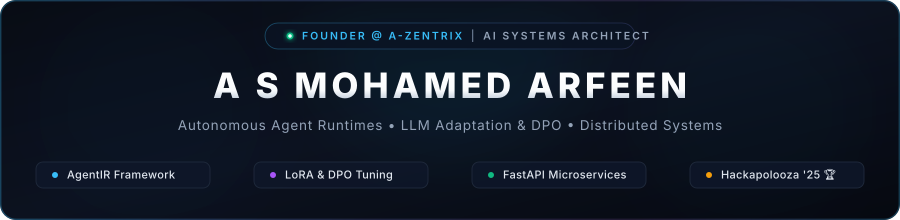

<div align="center">



<p align="center">
  <a href="https://linkedin.com/in/asmohamedarfeen/" target="_blank">
    
  </a>
  <a href="https://github.com/asmohamedarfeen" target="_blank">
    
  </a>
  <a href="mailto:asmohamed.arfeen@gmail.com">
    
  </a>
  <a href="https://asmohamedarfeen.github.io" target="_blank">
    
  </a>
  <a href="https://youtu.be/z7Sk1Dpd5xo" target="_blank">
    
  </a>
</p>


</div>

---

## 🧭 Executive Overview

I am an **AI Systems Architect** and the **Founder of A-Zentrix**, specializing in the design and production deployment of **agentic runtimes**, **domain-adapted LLMs**, and **high-throughput asynchronous distributed backends**.

My engineering discipline focuses on closing the gap between raw machine learning research and deterministic, production-grade software:
- **Agentic Infrastructure & Compilers:** Designing intermediate representations, static safety analyses, and execution DAG schedulers that reduce token costs and latency in autonomous multi-agent loops.
- **Parameter-Efficient LLM Adaptation:** Training domain-specialized small models (SLMs) via Supervised Fine-Tuning (**LoRA/PEFT**) and Direct Preference Optimization (**DPO**) for strict zero-hallucination JSON tool execution.
- **Multimodal Perception & Affective Computing:** Real-time 3D spatial computer vision, physiological stress telemetry, and edge-to-cloud inference pipelines.
- **Resilient Distributed Backends:** Building async FastAPI microservices, event-driven streaming with WebSockets, and low-latency vector retrieval engines.

```
┌────────────────────────────────────────────────────────────────────────────────────────┐
│  Agentic Compilers (AgentIR)  •  LoRA & DPO Alignment  •  Hybrid RAG  •  FastAPI Core  │
└────────────────────────────────────────────────────────────────────────────────────────┘
```

| Dimension | Specialization & Production Impact |
| :--- | :--- |
| 🚀 **Venture Leadership** | Founder of **A-Zentrix** — engineering sovereign AI products, agent workflows, and intelligent software systems. |
| ⚡ **Agent Workflows & Compilers** | Creator of **AgentIR** — compiler-inspired IR providing static validation, dead-code elimination, and parallel execution for agent DAGs. |
| 🧬 **LLM Fine-Tuning & Alignment** | Production LoRA/QLoRA and DPO fine-tuning on SLMs (e.g. Qwen2.5) for deterministic banking & fintech tool-calling pipelines. |
| 👁️ **Vision & Multimodal Systems** | Sub-100ms 3D landmark sequence translation (**SignSpeak**), 3D anatomical risk mapping (**CardioVision AI**), and emotion computing. |
| 🏆 **Honors & Recognition** | **Hackapolooza '25 Champion**, Smart India Hackathon Grand Finale solution architect for the Ministry of Home Affairs (CRPF). |

---

## 🚀 Featured Flagship AI Systems

<table>
  <!-- ROW 1 -->
  <tr>
    <td width="50%" valign="top">
      <h3>⚡ <a href="https://github.com/asmohamedarfeen/AgentIR">AgentIR</a></h3>
      <p><em>Compiler-Inspired Intermediate Representation & Optimization for AI Agent Workflows</em></p>
      <p>A static analysis and runtime optimization framework for complex LLM agent orchestrations (LangGraph, CrewAI, DAGs). Compiles agent graphs into a formal Intermediate Representation (IR) to eliminate redundant tool calls and schedule concurrent branches.</p>
      <ul>
        <li><b>Compiler Optimizations:</b> Dead-Code Elimination (DCE), Common Subexpression Elimination (CSE), and polymorphic IR nodes.</li>
        <li><b>Static Safety:</b> Ahead-of-time tool signature checks, permission validation, and infinite-loop prevention.</li>
        <li><b>Performance:</b> <b>3,800+ wps</b> compilation throughput, 100% benchmark validation accuracy, <b>50/50</b> pytest suite passing.</li>
      </ul>
      <p>
        
        
        
        
      </p>
      <p>🔗 <b><a href="https://github.com/asmohamedarfeen/AgentIR">Explore Repository →</a></b></p>
    </td>
    <td width="50%" valign="top">
      <h3>🧬 <a href="https://github.com/asmohamedarfeen/Fine-tuning-model-on-finance-domain-">FinLLM Tool Engine</a></h3>
      <p><em>Production Fine-Tuning with LoRA & DPO: Deterministic Fintech Tool Calling</em></p>
      <p>An end-to-end LLM fine-tuning pipeline transforming an off-the-shelf Small Language Model (<b>Qwen2.5-1.5B-Instruct</b>) into a zero-hallucination, deterministic banking tool-calling engine for enterprise fintech workflows.</p>
      <ul>
        <li><b>Two-Stage Alignment:</b> Supervised Fine-Tuning (SFT via LoRA/PEFT) followed by Direct Preference Optimization (TRL DPOTrainer).</li>
        <li><b>Deterministic Output:</b> Strict adherence to complex financial JSON schemas with deterministic tool dispatch.</li>
        <li><b>Validation & Telemetry:</b> <b>65/65</b> passing unit tests, detailed latency benchmarks, and verified video demonstration.</li>
      </ul>
      <p>
        
        
        
        
      </p>
      <p>🔗 <b><a href="https://github.com/asmohamedarfeen/Fine-tuning-model-on-finance-domain-">Explore Repository →</a></b> &bull; <b><a href="https://youtu.be/z7Sk1Dpd5xo">Watch Demo ↗</a></b></p>
    </td>
  </tr>

  <!-- ROW 2 -->
  <tr>
    <td width="50%" valign="top">
      <h3>🌐 <a href="https://github.com/asmohamedarfeen/CortexMesh">CortexMesh</a></h3>
      <p><em>Autonomous Multi-Agent Orchestration & Hybrid RAG Engine</em></p>
      <p>A production-ready distributed agent mesh executing dynamic multi-step problem solving with stateful memory, tool governance, and hybrid semantic retrieval.</p>
      <ul>
        <li><b>Stateful Coordination:</b> Cyclic agent state machine built with LangGraph, enabling dynamic self-correction and multi-agent debate.</li>
        <li><b>Hybrid RAG:</b> Dual-channel retrieval integrating dense vector embeddings with sparse BM25 scoring for precision factual grounding.</li>
        <li><b>Real-Time Streaming:</b> WebSocket-driven asynchronous token and state streaming via high-concurrency FastAPI backends.</li>
      </ul>
      <p>
        
        
        
        
      </p>
      <p>🔗 <b><a href="https://github.com/asmohamedarfeen/CortexMesh">Explore Repository →</a></b></p>
    </td>
    <td width="50%" valign="top">
      <h3>🎛️ <a href="https://github.com/asmohamedarfeen/CogniCanvas">CogniCanvas</a></h3>
      <p><em>Visual Cockpit & Observability Platform for Autonomous AI Coding Agents</em></p>
      <p>An interactive, observable engineering control plane designed to monitor, inspect, and orchestrate fleets of autonomous coding agents in real time.</p>
      <ul>
        <li><b>Execution Telemetry:</b> Live DAG graph rendering of agent reasoning steps, tool invocations, and file-system mutation logs.</li>
        <li><b>Multi-Agent Governance:</b> Policy enforcement, token consumption analytics, and human-in-the-loop intervention gates.</li>
        <li><b>Modern Stack:</b> High-performance React 18, TypeScript, Tailwind CSS, and Playwright verification harness.</li>
      </ul>
      <p>
        
        
        
        
      </p>
      <p>🔗 <b><a href="https://github.com/asmohamedarfeen/CogniCanvas">Explore Repository →</a></b></p>
    </td>
  </tr>

  <!-- ROW 3 -->
  <tr>
    <td width="50%" valign="top">
      <h3>🫀 <a href="https://github.com/asmohamedarfeen/IIT-Mandi-Hackathon-">CardioVision AI</a></h3>
      <p><em>Interactive 3D Cardiovascular Risk Intelligence & Multi-Vessel Stenosis Spatial Mapping</em></p>
      <p>Clinical diagnostic AI platform trained on patient clinical cohorts to predict coronary artery disease and project stenosis severity onto interactive 3D WebGL anatomical heart models.</p>
      <ul>
        <li><b>Diagnostic Performance:</b> Achieves <b>94.7% ROC-AUC</b> across multi-vessel coronary artery disease prediction benchmarks.</li>
        <li><b>3D Spatial Mapping:</b> WebGL/Three.js interactive anatomical rendering highlighting LAD, LCx, and RCA vessel stenosis.</li>
        <li><b>Verification:</b> Over <b>224 automated tests</b> passing with production Docker and FastAPI microservices.</li>
      </ul>
      <p>
        
        
        
        
      </p>
      <p>🔗 <b><a href="https://github.com/asmohamedarfeen/IIT-Mandi-Hackathon-">Explore Repository →</a></b></p>
    </td>
    <td width="50%" valign="top">
      <h3>🤟 <a href="https://github.com/asmohamedarfeen/Sign-language-direction-model-">SignSpeak</a></h3>
      <p><em>Real-Time 3D Hand Landmark Sign Language to English Translation Engine</em></p>
      <p>Enterprise-grade computer vision and sequence modeling engine translating continuous 3D spatial sign gestures into natural vocalized English speech and text in real time.</p>
      <ul>
        <li><b>Spatial Feature Extraction:</b> 60 FPS 3D hand landmark coordinate normalization and temporal trajectory tracking via MediaPipe.</li>
        <li><b>Sequence Classification:</b> Deep bidirectional neural architecture for dynamic gesture classification and syntax ordering.</li>
        <li><b>Sub-100ms Pipeline:</b> Full duplex WebSockets bridging client camera frames with FastAPI inference and Web Speech synthesis.</li>
      </ul>
      <p>
        
        
        
        
      </p>
      <p>🔗 <b><a href="https://github.com/asmohamedarfeen/Sign-language-direction-model-">Explore Repository →</a></b></p>
    </td>
  </tr>

  <!-- ROW 4: Large Banner for National Impact -->
  <tr>
    <td colspan="2" valign="top">
      <h3>🛡️ <a href="https://github.com/asmohamedarfeen/sih_web_app">KAIZEN : PSWMS</a> &bull; <em>Smart India Hackathon Grand Finale Solution</em></h3>
      <p><b>AI-Based Predictive Personnel Stress & Welfare Monitoring System for Uniformed Forces</b><br/>
      <em>Ministry of Home Affairs (MHA) &bull; Central Reserve Police Force (CRPF) &bull; Police II Division</em></p>
      <p>An ethical, proactive, privacy-preserving AI architecture designed to predict and mitigate extreme operational fatigue, PTSD risk, and burnout among high-hazard uniformed service personnel before acute crises emerge.</p>
      <ul>
        <li><b>Predictive Analytics Engine:</b> Multi-signal ingestion analyzing anonymized duty rosters, deployment cycles, voluntary psychometric assessments (PHQ-9/GAD-7), and biometric trendlines.</li>
        <li><b>Zero-Knowledge Ethics & Compliance:</b> Full DPDP Act 2023 compliance, cryptographic anonymization, and zero-knowledge role-based access control (RBAC) to eliminate career stigmatization.</li>
        <li><b>Full-Stack Ecosystem:</b> Asynchronous FastAPI backend (<b>37/37 passing pytest suite</b>), high-density React 18 analytical command dashboard, and offline-capable Flutter mobile client.</li>
      </ul>
      <p>
        
        
        
        
        
        
      </p>
      <p>🔗 <b><a href="https://github.com/asmohamedarfeen/sih_web_app">Explore SIH Web App →</a></b> &bull; <b><a href="https://github.com/asmohamedarfeen/KAI-ZEN">Explore Research & Proposal Model →</a></b></p>
    </td>
  </tr>
</table>

---

## 🛠️ Technical Ecosystem & Core Stack

<div align="center">

<p align="center">
  
</p>

</div>

### 🧠 Agentic AI, LLMs & Model Adaptation
`PyTorch` • `Hugging Face (Transformers, PEFT, TRL)` • `LoRA & QLoRA` • `Direct Preference Optimization (DPO)` • `LangGraph` • `LangChain` • `CrewAI` • `vLLM` • `Ollama` • `Compiler IR Design` • `Prompt Engineering` • `Structured Tool Calling`

### 👁️ Computer Vision & Multimodal Perception
`OpenCV` • `MediaPipe (3D Spatial Landmarks)` • `CNNs` • `Bi-LSTM Sequences` • `Three.js (WebGL)` • `Affective Computing` • `Acoustic Speech Analysis` • `Scikit-Learn` • `NumPy & Pandas`

### ⚡ Backend Engineering & Systems Architecture
`FastAPI (Asynchronous)` • `Python 3.11–3.13` • `C++` • `Java` • `WebSockets` • `Uvicorn / Gunicorn` • `RESTful Microservice Architecture` • `Asynchronous I/O` • `Celery Task Workers` • `Pydantic V2`

### 🗄️ Vector Storage, Databases & Infrastructure
`PostgreSQL (pgvector)` • `ChromaDB` • `MySQL` • `Redis (Caching & Message Broker)` • `Alembic Migrations` • `Docker & Docker Compose` • `Kubernetes` • `Linux (Ubuntu/Debian)` • `CI/CD Automation`

---

## 🏆 Honors, Leadership & Impact

* 🥇 **Champion — Hackapolooza '25**: Awarded 1st place for architecting and deploying cutting-edge AI-driven solutions under high-intensity sprint constraints.
* 🛡️ **Finalist & Solution Architect — Smart India Hackathon (SIH)**: Selected by Ministry of Home Affairs (CRPF) for developing **KAIZEN : PSWMS**, an ethical AI predictive stress and welfare monitoring platform.
* 🚀 **Founder @ A-Zentrix**: Spearheading product engineering, agentic architecture research, and enterprise AI delivery.
* 🎙️ **Keynote Speaker & AI Educator**: Delivered masterclasses and technical workshops on Generative AI architectures, LLMOps, fine-tuning methodologies, and agent orchestration.
* ⚡ **Systems Mentor**: Mentoring early-career software engineers and AI developers in building production-grade FastAPI backends and distributed systems.

---

<div align="center">

### 🎯 Architectural Philosophy

> *"True AI engineering begins where prompt wrappers end — through rigorous model alignment, compiler-grade agent orchestration, and mathematically deterministic system execution."*

<br />

<p align="center">
  <b>Looking to collaborate, architect mission-critical AI systems, or discuss intelligent agents?</b><br />
  Connect via <a href="https://linkedin.com/in/asmohamedarfeen/">LinkedIn</a> &bull; Reach out at <a href="mailto:asmohamed.arfeen@gmail.com">asmohamed.arfeen@gmail.com</a> &bull; Check out <a href="https://asmohamedarfeen.github.io">Portfolio</a>
</p>


</div>
